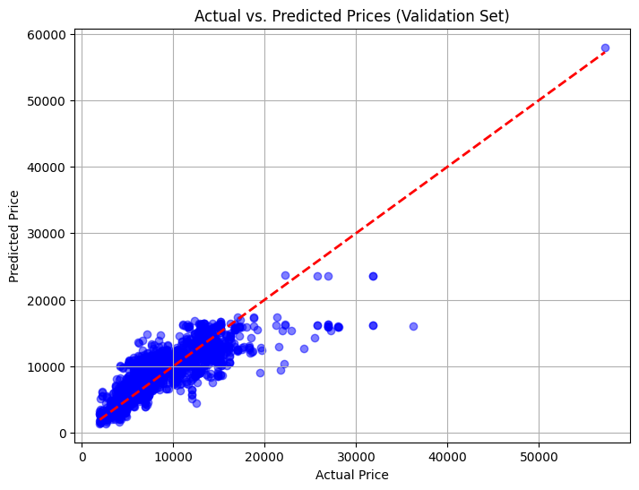
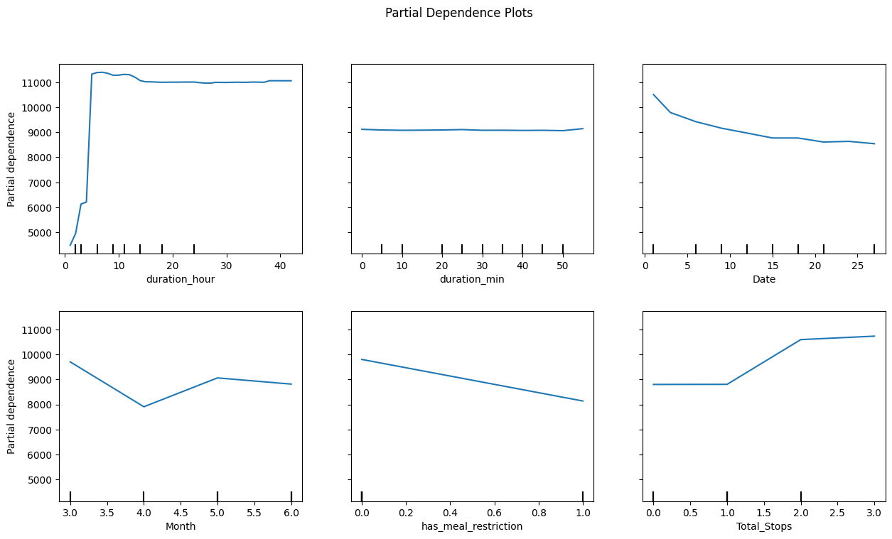
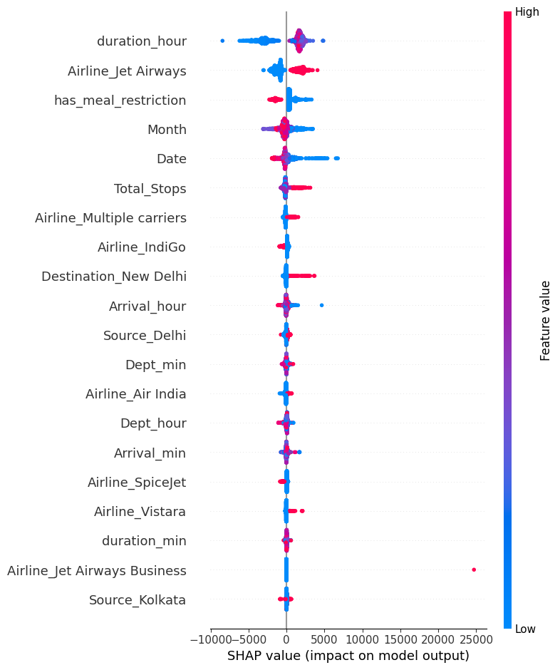
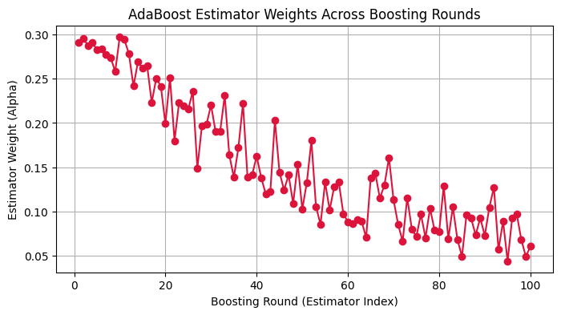

# Flight Price Prediction

Predicts flight ticket prices using machine learning trained on 10K+ historical flights from Indian airlines.

## Quick Start

```bash
# Install dependencies
pip install -r requirements.txt

# Run the web app
streamlit run app.py
```

Then open http://localhost:8501 and enter flight details to get a price prediction.

## Results

### Model Performance Comparison

| Model | Val MAE | Val RMSE | Val R² | Overfit Gap |
|-------|---------|----------|--------|-------------|
| Linear Regression | ₹1,746 | ₹2,483 | 0.7083 | 0.0217 |
| **Random Forest** | **₹756** | **₹1,565** | **0.8842** | **0.0806** |
| XGBoost | ₹922 | ₹1,482 | 0.8961 | 0.0250 |
| AdaBoost | ₹2,383 | ₹3,110 | 0.5425 | 0.3986 |

**Winner:** Random Forest with lowest validation MAE (₹756) — predicts flight prices within ±₹756 on average.

---

### Model Visualizations

#### 1. **Actual vs. Predicted Prices** (Linear Regression)
Shows how well the model's predictions align with real prices. The scatter plot shows Linear Regression captures the general trend but with more spread.



#### 2. **Random Forest Analysis: Partial Dependence Plots**
Shows which features most influence price predictions:
- **Duration (hours):** Sharp jump in first 10 hours, then plateaus (longer flights cost more)
- **Month:** Slight U-shape pattern (mid-season cheaper, peak season more expensive)
- **Total Stops:** Increases with each stop (direct flights cheapest)
- **Meal Service:** Flights with meal restrictions cost less



#### 3. **XGBoost Interpretability: SHAP Summary Plot**
Shows which features contribute most to predictions:
- **Top contributors:** Flight duration (hours), Jet Airways airline, meal restrictions, month
- **Red/Blue colors:** Red = higher values increase price; Blue = lower values increase price
- Example: Longer duration → higher price (red dots on right)



#### 4. **AdaBoost Boosting Process**
Shows how AdaBoost iteratively improves by focusing on harder examples:
- **Decreasing weights:** Estimator importance drops over 100 rounds
- **Why it underperformed:** Struggled to fit this data (regression easier with RF/XGBoost)



---

### Key Insights

1. **Duration is the strongest price driver** — each additional hour significantly increases fare
2. **Airline matters** — Jet Airways and premium carriers charge more
3. **Seasonal variation** — March-April cheaper (off-season), November-December expensive (peak)
4. **Direct flights preferred** — each stop adds ₹2,000+ to fare
5. **Random Forest works best** — simpler than XGBoost but captures non-linear patterns better for this dataset

## Files

- `app.py` — Streamlit web interface
- `src/data_pipeline.py` — Data cleaning & feature engineering
- `src/train.py` — Model training & comparison
- `src/predict.py` — Inference module
- `models/flight_price_model.pkl` — Trained Random Forest model
- `notebooks/Training.ipynb` — Full training notebook with exploration

## Features

The model uses these features to predict price:

- **Date/Time:** Departure date (day, month, year), departure time (hour, minute), arrival time (hour, minute)
- **Duration:** Flight duration in minutes
- **Route:** Source and destination cities
- **Stops:** Number of stops (0, 1, 2, etc.)
- **Airline:** Which airline operates the flight
- **Additional Info:** Presence of meal, baggage, or layover information

## Process

1. **Data Cleaning:** Handled mixed time formats ("10 22 Mar"), missing values, and string encodings
2. **Feature Engineering:** Extracted date/time components, one-hot encoded categories, created binary flags
3. **Model Selection:** Trained Linear Regression, Random Forest, XGBoost, and AdaBoost; Random Forest performed best
4. **Hyperparameter Tuning:** Used RandomizedSearchCV to optimize model
5. **Deployment:** Built Streamlit app for interactive predictions

## What I Learned

- **Data messy is normal:** Real-world data has mixed formats, missing values, and encoding issues. Handling them without dropping rows is critical.
- **Model comparison matters:** Random Forest outperformed XGBoost on this dataset with better MAE and lower overfitting gap (0.0806 vs 0.0530).
- **Feature engineering > fancy models:** Proper datetime parsing and categorical encoding contributed more to accuracy than model selection.
- **Modular code pays off:** Separating data pipeline, training, and prediction into different modules made the project maintainable and testable.

## Author

Built as a portfolio project to demonstrate:
- End-to-end ML pipeline (data → model → deployment)
- Production-style code (clean, modular, testable)
- Real-world problem solving (messy data handling)
- Model evaluation and comparison

---

Want to predict flight prices? Run `streamlit run app.py` and try it out!
